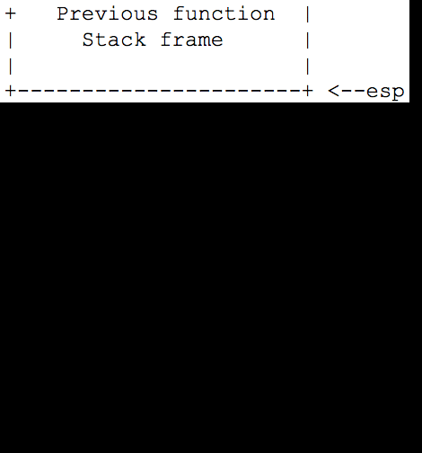

# Lecture 1: メモリを理解する
[](https://gitprint.com/r0hi7/BinExp/master/Lecture1/README.md).

[講義動画 (ヒンディー語)](https://www.youtube.com/watch?v=cNtbqYgOQuk&t=8s)

この講義では、次のことを扱います。
* **ELF** ファイルが、実行時に **メモリ上** でどのように見えるか。
* 関数呼び出し時の **スタック** の構成。
* アセンブリとは何か。アセンブリコードはどのように見えるか。
* `$ebp` と `$esp` とは何か。

### ELF
> In computing, the Executable and Linkable Format (ELF, formerly named Extensible Linking Format), is a common standard file format for executable files, object code, shared libraries, and core dumps.
参照: [ELF](https://en.wikipedia.org/wiki/Executable_and_Linkable_Format)

難しくて頭に入ってこなかったでしょうか。心配はいりません。かみ砕いて説明します。
ELF は基本的に、コード(実行可能またはリンク可能なバイナリコード)がメモリ上でどのように見えるかを定めた形式です。ELF ヘッダには、ELF ファイルの内容に関する多くの情報が入っています。次のコマンドで ELF のヘッダを見られます。ここでは、このリポジトリにあるファイルの1つに対して実行しています。
`readelf -h ./function_call`
```
ELF Header:
  Magic:   7f 45 4c 46 01 01 01 00 00 00 00 00 00 00 00 00
  Class:                             ELF32
  Data:                              2's complement, little endian
  Version:                           1 (current)
  OS/ABI:                            UNIX - System V
  ABI Version:                       0
  Type:                              EXEC (Executable file)
  Machine:                           Intel 80386
  Version:                           0x1
  Entry point address:               0x8048310
  Start of program headers:          52 (bytes into file)
  Start of section headers:          6860 (bytes into file)
  Flags:                             0x0
  Size of this header:               52 (bytes)
  Size of program headers:           32 (bytes)
  Number of program headers:         9
  Size of section headers:           40 (bytes)
  Number of section headers:         36
  Section header string table index: 33
```
ここでは次の2点に注目してください。この講座でも重要になります。
1. **Type:** EXEC。このバイナリファイルが実行可能ファイルであることを表します。
2. **Data:** 2's complement, **little endian**。このファイルが、アドレスをリトルエンディアン表記で扱うマシン向けにコンパイルされていることを表します。[これらは何?](https://en.wikipedia.org/wiki/Endianness)

### ELF ファイルはメモリ上でどう見えるか
```
                        +---------------+ Highest Address 0xffffffff
                        | cmd line args |
                        | env Variable  |
                        +---------------+
                        |     STACK     |
                        +--+------------+
                        |  |            |
                        |  |            |
                        |  v         ^  |
                        |            |  |
                        |            |  |
                        +------------+--+
                        |     HEAP      |
                        +---------------+
                        | Uninitialized |
                        |   Data(BSS)   |
                        +---------------+
                        |  Initialized  |
                        |     Data      |
                        +---------------+
                        |   Read Only   |
                        |     data      |
                        |       +       |
                        |     code      |
                        +---------------+ Lowest Address 0X00000000
```
上の図は、32ビットのバイナリがメモリに読み込まれたときの、4GBの仮想アドレス空間の様子を示しています。わかりやすいように、スタックは上から下の順、つまり最上段が最も高いアドレス、最下段が最も低いアドレスとして描いています。
各セクションを(上から)見ていきましょう。
1. 最初のセクションには、プログラムの実行時に渡されるコマンドライン引数と環境変数が入ります。

2. **Stack**: 関数の内部で作られる動的な変数を保存します。
**\*alloc 系の関数で作られる動的変数と混同しないでください。** プログラムの変数はどれも、メモリが割り当てられるのが実行時だけという意味では動的です。関数の中で普通に宣言した変数は、スタックに置かれます。**スタックは逆向きに伸びます**。つまり、高いアドレスから低いアドレスへ伸びます。

3. **Heap**: \*alloc 系の関数で作られる動的変数です。

4. **BSS**: 初期化されていない(グローバル変数と static 変数の)変数を保存します。
これらは自動的に **0** で初期化されます。

5. 次のセクションには、何らかの値で初期化された(**グローバル変数と static 変数の**)変数が入ります。

6. 最後のセクションには、**読み取り専用** の変数と、プログラムのコード(バイナリ)がすべて入ります。

### 関数呼び出し時のスタックの構成
スタックは関数呼び出しのとき、呼び出し元の関数の状態を保存するために使われます。呼び出された関数から戻ったときに、呼び出し元が通常どおり実行を続けられるようにするためです。関数呼び出しが行われた後のスタックは、次のようになります。

```
                        +   Previous function  |
                        |     Stack frame      |
                        |                      |
                        +----------------------+ <--- previous function stack frame end here
                        |Space for return value|
                        +----------------------+
                        |Arguments for function|
                        +----------------------+
                        |    return address    |
                        +----------------------+
                        |     saved $ebp       |
                        +----------------------+
                        |                      | <---  padding done by compilers
                        +----------------------+
                        |    local variables   |
                        |                      |
                        |                      |
                        |                      |
                        |                      |
                        +----------------------+
                        |                      |
                        |                      |
                        |     unused space     |
                        +                      +
```
### スタックの伸び方
ここで、`$ebp` と `$esp` が何に使われるのかを理解しましょう。

低いメモリアドレスの方向へ伸びます。

1. **esp**: 上の図のとおり、スタックポインタ(esp)はスタックへの push のたびに変わり続けます。実際には、スタックの先頭(最上位)を指すポインタを保持するために使われます。
2. **ebp**: 実行時には、変数は名前としては存在しません。変数は、スタックフレームの基底(base)からの相対位置として保存されます。この基底を指すのが ebp レジスタです。そのため、関数が別の関数を呼ぶときには ebp レジスタの値がスタックに保存され、ebp レジスタは新しいスタックフレームを格納するために使えるようになります。

### アセンブリ言語
アセンブリは、機械語のすぐ上にある言語だと考えてください。C のような高水準言語は、まずアセンブリ言語にコンパイルされ、そのあと機械語に変換されます。
関数呼び出しのコードがどのように見えるか、例を見てみましょう。
`objdump -d ./function_call`
```
0804840b <foo>:
 804840b:    55                       push   %ebp
 804840c:    89 e5                    mov    %esp,%ebp
 804840e:    83 ec 08                 sub    $0x8,%esp
 8048411:    83 ec 0c                 sub    $0xc,%esp
 8048414:    68 d0 84 04 08           push   $0x80484d0
 8048419:    e8 c2 fe ff ff           call   80482e0 <printf@plt>
 804841e:    83 c4 10                 add    $0x10,%esp
 8048421:    90                       nop
 8048422:    c9                       leave
 8048423:    c3                       ret

08048424 <main>:
 8048424:    8d 4c 24 04              lea    0x4(%esp),%ecx
 8048428:    83 e4 f0                 and    $0xfffffff0,%esp
 804842b:    ff 71 fc                 pushl  -0x4(%ecx)
 804842e:    55                       push   %ebp
 804842f:    89 e5                    mov    %esp,%ebp
 8048431:    51                       push   %ecx
 8048432:    83 ec 04                 sub    $0x4,%esp
 8048435:    e8 d1 ff ff ff           call   804840b <foo>
 804843a:    b8 00 00 00 00           mov    $0x0,%eax
 804843f:    83 c4 04                 add    $0x4,%esp
 8048442:    59                       pop    %ecx
 8048443:    5d                       pop    %ebp
 8048444:    8d 61 fc                 lea    -0x4(%ecx),%esp
 8048447:    c3                       ret
 8048448:    66 90                    xchg   %ax,%ax
 804844a:    66 90                    xchg   %ax,%ax
 804844c:    66 90                    xchg   %ax,%ax
 804844e:    66 90                    xchg   %ax,%ax
```
ここでは main 関数と foo 関数のコードだけをコピーしました。main から foo 関数を呼び出す部分を見てください。
1. main は関数呼び出しの前に何も push していないようです。つまり、foo は引数を取りません。
2. call 命令は CPU に、戻りアドレス(命令ポインタの次のアドレス)をスタックに保存するよう指示します。これは **call** 命令が行うので、コードの上には現れません。
3. **foo** の最初の命令は、**$ebp** をスタックに push することです。
4. その直後の命令は、**$ebp** が **$esp** を指すようにすることです。
これらの命令は3つの部分に分けられます。下の流れ図で説明します。

```
      main                                                                foo
+-----------------+                                               +-----------------+
|                 |                                               |                 |
|1. ret val space |                                               |1. pushes ebp    |
|2. arguments     | +------------->CALL Inst +------------------> |2. updates ebp   |
|                 |                    +                          |                 |
|                 |                    v                          |                 |
+-----------------+       Pushes the return address               +-----------------+

```

### アセンブリ言語 その2
前の **アセンブリ言語** の節のコードでは、単純な関数呼び出しのコードがどのように見えるかを示しました。この節では、バッファが **asm** コードの中でどのように見えるかを示します。
```c
#include <stdio.h>
void foo()
{
    char ch[10];
    printf("Calling from fucntion");
}

int main()
{
    foo();
    return 0;
}
```
対応する foo 関数のアセンブリです。
```
0804840b <foo>:
 804840b:    55                       push   %ebp
 804840c:    89 e5                    mov    %esp,%ebp
 804840e:    83 ec 18                 sub    $0x18,%esp
 8048411:    83 ec 0c                 sub    $0xc,%esp
 8048414:    68 d0 84 04 08           push   $0x80484d0
 8048419:    e8 c2 fe ff ff           call   80482e0 <printf@plt>
 804841e:    83 c4 10                 add    $0x10,%esp
 8048421:    90                       nop
 8048422:    c9                       leave
 8048423:    c3                       ret
```
2つの sub 命令に注目してください。
```
804840e:    83 ec 18                 sub    $0x18,%esp
8048411:    83 ec 0c                 sub    $0xc,%esp
```
1つ目の sub は今のところ無視してかまいませんが、2つ目は重要です。esp に対する2つ目の sub が、実際にスタックを更新して **ch** バッファの領域を確保します。前に述べたとおり、**asm** では名前は意味を持たず、$esp や $ebp からの相対参照にすぎないことに注意してください。
