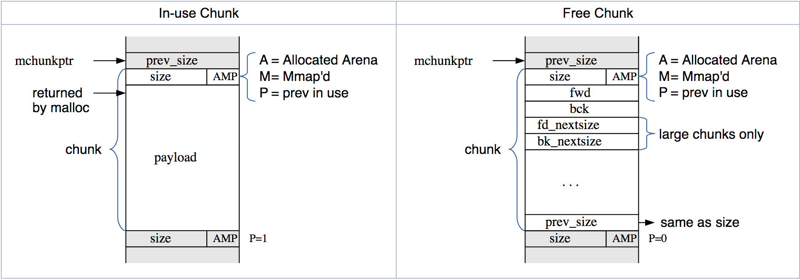

# ヒープを理解する
> One Heap to malloc them all, One Heap to free them, One Heap to coalesce, and in the memory bind them...

先に進む前に、**C の `malloc` 関数と `free` 関数** についての十分な知識があることを前提にします。これはヒープ exploit の入門講義で、アプリケーションがヒープをどう管理するかを扱います。この講義では、ヒープ管理における `glibc` の実装を扱います。
この講義で扱う予定の内容です。
1. ヒープと、動的メモリ管理の関数
    * `malloc` と `free` の基本。
2. `sbrk` と `mmap`
2. Arena
3. Bin
4. チャンク
5. **`fastbins`** がいかにだまされやすいかを示す、単純な exploit。

### Heap

ヒープ(Heap)は、`*alloc` 系の関数で動的に作られる変数を保存するためのメモリ領域です。この動的変数を、スタック上の変数と混同しないでください。スタック上の変数も実行時に確保されますが、ヒープの場合は、実行時に `*alloc` 系の関数によって作られます。
このセグメントに作られるメモリは、プログラム内のどの関数やスレッドからも共有できるという意味で、グローバルです。ポインタで扱います。ポインタにあまり慣れていなければ、先に進む前に[このガイド]()を参照してください。
次の図は、アプリケーションがメモリ管理の呼び出しをどう行うか、またその構成要素のうちどれがシステムに依存し、どれが依存しないかを示しています。
```
                             +--------------+
                             | Application  |
                             +------+-------+
                                    |
                                    |
                                    |
                             +------v-------+    System independent glibc
                             |    malloc    |    implementation
                          +--+--------------+--+
                          |                    |
                          |                    |
                          |                    |
                    +-----v------+     +-------v-----+
                    |    _brk    |     |    _mmap    |  System specific heap
                    +------------+     +-------------+  management calls
```
`brk` は、プログラムブレーク位置(brk)を増やすことで、カーネルからメモリ(ゼロで初期化されていないもの)を取得します。最初は、ヒープセグメントの開始(`start_brk`)と終端(`brk`)は同じ位置を指します。`start_brk` は、プログラムの実行中、(ASLR が無効な場合は)BSS の終端を指すメモリ上のセグメントを指します。プログラムの `start_brk` の値は、`sbrk()` システムコールに引数 `0` を渡すことで取得できます。
`sbrk` の呼び出しがどう動くか見てみましょう。
```C
#include <stdio.h>
#include <unistd.h>
#include <sys/types.h>

int main()
{
    printf("Current program pid %d\n", getpid());
    printf("Current break location %p\n", sbrk(0));
    //プログラムブレーク位置を増減するために使う
    brk(sbrk(0) + 1024);
    printf("Current break location %p\n", sbrk(0));
    getchar();
    return 0;
}
```

```bash
Current program pid 10316
Current break location 0x9380000    <----- Current brk
Current break location 0x9380400
```

そして、プロセスはメモリ上で次のように見えます。
```bash
$ cat /proc/10316/maps/
08048000-08049000 r-xp 00000000 00:27 45                                 /vagrant/Lecture7/brk_test
08049000-0804a000 r--p 00000000 00:27 45                                 /vagrant/Lecture7/brk_test
0804a000-0804b000 rw-p 00001000 00:27 45                                 /vagrant/Lecture7/brk_test
0935f000-09381000 rw-p 00000000 00:00 0                                  [heap]     <------------------- Heap segment
...
```
`0935f000-09381000` は、このセグメントの仮想アドレス範囲です。
`rw-p` はフラグです(Read, Write, Non-Xecute, Private)。
`00000000` はファイルオフセットです。どのファイルからもマップされていないので、ここでは0です。
`00:00` はメジャー/マイナーのデバイス番号です。どのファイルからもマップされていないので、ここでは0です。
`0` は inode 番号です。どのファイルからもマップされていないので、ここでは0です。

`sbrk` と `brk` はプログラムブレークのオフセットを取得・設定するために使われますが、一方 `mmap` は、カーネルからメモリを取得してヒープに加え、プログラムの `brk` を更新するために使われます。
ここまでに説明した関数で、ヒープメモリを管理できます。ここから、`Heap` の全体像をもう少し明らかにします。


### ヒープの構成

ヒープには、`glibc` が実装した、ヒープを簡単に操作するためのさまざまな割り当て単位があります。この割り当て単位は、Arena、Bin、チャンク(Chunk)です。

#### Arena:
マルチスレッドのアプリケーションを効率よく扱うために、`glibc の malloc` は、複数のメモリ領域を同時に有効にできます。これにより、異なるスレッドが互いに干渉せずに、異なるメモリ領域にアクセスできます。これらのメモリ領域をまとめて `arenas` と呼びます。
アプリケーションの最初のヒープに対応する arena が1つあり、これを `main arena` と呼びます。`malloc` のコードには、この arena を指す静的変数があり、各 arena には、ほかの arena をつなぐための next ポインタがあります。
わかりやすく言うと、(仮想アドレスに割り当てられた)物理的なヒープが、arena に分割されています。main arena は、プログラムブレーク `start_brk` の直後から始まります。Arena の中には、bin の集まりが入っています。


#### Bin:
Bin は、`chunks` と呼ばれる、空きメモリの割り当て単位の集まりです。1つの arena には、用途に応じた4種類の bin があります。そして各 bin には、空きチャンクを追跡する割り当てデータ構造が入っています。** どの arena も(つまり arena 内の bin は)、確保済みのチャンクを追跡しません **。各 arena には、特定の bin が特定の個数ずつあります。

4種類の bin は次のとおりです。
1. **Fast**。
    fast bin は10個あります。各 bin は、単方向リストを保持します。追加と削除は、このリストの先頭で行われます(LIFO 方式)。各 bin には、同じサイズのチャンクが入ります。10個の bin はそれぞれ、16、24、32、40、48、56、64バイトなどのサイズのチャンクを持ちます。隣り合う2つの空き fast チャンクは、統合(coalesce)されません。

2. **Unsorted**。
    small チャンクと large チャンクが解放(free)されると、まずこの bin に格納されます。unsorted bin は1つだけです。

3. **Small**。
    通常の bin は、各チャンクが同じサイズである「small」bin と、チャンクのサイズに幅がある「large」bin に分けられます。チャンクがこれらの bin に追加されるときは、まず隣接するチャンクと結合(coalesce)されて、より大きなチャンクになります。そのため、これらのチャンクが同種のチャンクに隣り合うことはありません(fast や unsorted のチャンク、そしてもちろん使用中のチャンクには隣り合うことがあります)。small チャンクと large チャンクは双方向リストでつながれているので、(新しく解放されたチャンクと結合するときなどに)リストの途中からチャンクを取り除けます。

4. **Large**。
    bin が複数のサイズを含みうるとき、そのチャンクは「large」です。small bin では、最初のチャンクを選んでそのまま使えます。large bin では、「最適な」チャンクを探し、場合によっては2つのチャンク(必要なサイズのものと、残りのもの)に分割しなければなりません。

#### チャンク:
チャンク(Chunk)は、bin の基本的な割り当て単位です。ヒープ内のメモリは、(どの bin に)割り当てられるかに応じて、さまざまなサイズのチャンクに分割されます。各チャンクには、(チャンクヘッダの size フィールドによって)自分の大きさと、それによって隣接するチャンクがどこにあるかというメタデータが入っています。チャンクが解放されると、それまでアプリケーションのデータだったメモリは、リスト内のポインタのような arena 関連の追加情報に転用されます。これにより、必要なときに適切なチャンクをすばやく見つけて再利用できます。チャンクのサイズは常に8の倍数なので、下位3ビットをフラグとして使えます。

この3つのフラグは次のとおりです。
- **A**
    Allocated Arena - main arena はアプリケーションのヒープを使います。ほかの arena は mmap されたヒープを使います。チャンクをヒープに対応づけるには、どちらの場合かを知る必要があります。このビットが0なら、チャンクは main arena と main heap のものです。このビットが1なら、チャンクは mmap されたメモリのもので、ヒープの位置はチャンクのアドレスから計算できます。
- **M**
    MMap\'d chunk - このチャンクは mmap の1回の呼び出しで確保されたもので、ヒープの一部ではまったくありません。
- **P**
    Previous chunk is in use - これが設定されていると、直前のチャンクはまだアプリケーションに使われているので、prev_size フィールドは無効です。注意: (後述する)fastbin にあるチャンクなど、アプリケーションに解放されたにもかかわらず、このビットが設定されているチャンクもあります。このビットが本当に意味するのは、直前のチャンクを統合の候補とみなしてはならない、ということです。つまり、そのチャンクは、アプリケーションか、malloc の元のコードの上に重ねられた何らかの最適化層のどちらかに「使用中」とされています :-)

チャンクは次のようになっています。


### small/medium bin の確保:
`glibc` の malloc は、small/large bin のチャンクの確保に first fit アルゴリズムを使います。この実装では、名前のとおり、新しい要求のサイズを扱える最初の適切な空きメモリ位置が、必要に応じて分割され、新しい要求に割り当てられます。
`use after free exploit` で何が起きているか見てみましょう。

```C
#include <stdio.h>
#include <stdlib.h>
#include <string.h>

int main()
{
    printf("If a chunk is free and large enough, malloc will select this chunk.\n");
    printf("This can be exploited in a use-after-free situation.\n");

    char* a = malloc(512);
    char* b = malloc(256);
    char* c;

    printf("1st malloc(512): %p\n", a);
    printf("2nd malloc(256): %p\n", b);
    strcpy(a, "this is A!");
    printf("first allocation %p points to %s\n", a, a);

    printf("Freeing the first one...\n");
    free(a);

    printf("We don't need to free anything again. As long as we allocate less than 512, it will end up at %p\n", a);

    printf("So, let's allocate 500 bytes\n");
    c = malloc(500);
    printf("3rd malloc(500): %p\n", c);
    printf("And put a different string here, \"this is C!\"\n");
    strcpy(c, "this is C!");
    printf("3rd allocation %p points to %s\n", c, c);
    printf("first allocation %p points to %s\n", a, a);
    printf("If we reuse the first allocation, it now holds the data from the third allocation.");
}
```
プログラムを実行して、ポインタ `c` とポインタ `a` が同じ場所を指していることに注目してください。
small チャンクや large チャンク(と bin)では、use after free の exploit が成立する見込みがあります。これは、解放されたポインタを、解放後にも exploit できるというものです。

### fast bin の確保:
前に述べたとおり、fastbin は単方向リストとして管理されます。「fastbin が管理される」と言うとき、対象は空きチャンクのことです。**bin が指すのは空きチャンクだけで、確保済みのチャンクは指さないことを、いつも覚えておいてください。** 確保済みのチャンクの面倒を見て、使わなくなったら解放するのは、プログラマーの責任です。
チャンクが解放されると、fast bin リストの先頭に追加されます。確保されるときは、先頭のノードのチャンクがリストから取り除かれて、割り当てに回されます。
適切に管理されていないと、fastbin は `double free` の exploit に使われることがあります。これは、プログラマーが誤って同じメモリを2回解放してしまい、攻撃者がそれを利用して悪意のあることを行うものです。
次のコードを見てください。
```C
#include <stdio.h>
#include <stdlib.h>
int main()
{
    void *a, *b, *c, *d, *e, *f;
    a = malloc(32);
    b = malloc(32);
    c = malloc(32);

    printf("%p %p %p\n", a, b, c);
    free(a);                                //fastbin head -> a > tail
    //double free の検出や fasttop のチェックを避けるため、a 以外のものを解放する
    free(b);                                //fastbin head b -> a > tail
    free(a);                                //fastbin head a -> b -> a > tail

    d = malloc(32);                         //fastbin head -> b -> a -> tail 最初に a が取り出される
    e = malloc(32);                         //fastbin head -> a -> tail 最初に b が取り出される
    f = malloc(32);                         //fastbin head -> tail 2回目の a が取り出される
    printf("%p %p %p", d, e, f);
    return 0;
}
```
これにより、ポインタ `d` と `f` が同じメモリ位置を指すようになります。これを double free の exploit と呼びます。
